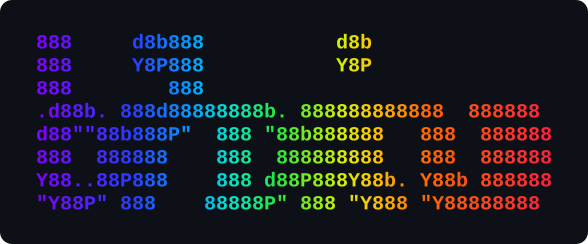

<p align="center"></p>

<h1 align="center">orbitui</h1>

**When will a satellite image my area?** `orbitui` is a terminal planner of Earth
observation overpasses. It propagates the orbits of Sentinel, Landsat, CBERS,
MODIS, VIIRS and other missions, and tells you when your area of interest falls
inside each sensor's swath, with the viewing geometry and the Sun at the time.

Generic pass predictors answer "when is the satellite above my horizon".
`orbitui` answers the remote sensing question: is the target *inside the imaged
strip*, how far off-nadir, ascending or descending, and is it daylight for an
optical sensor.

Pure Rust, one binary, runs in Windows Terminal, PowerShell, CMD, bash, zsh,
over SSH, and **in the browser**: <https://sacridini.github.io/orbitui/>.

## Screens

**Monitor** (`1`): a live globe (or flat map, `m`) with the day/night
terminator, coastlines lit by the Sun, every satellite in its true position,
and for the selected one its ground track, swath edges and visibility circle.
Beside it, the fleet with live positions and the time to each satellite's next
image of your area.

**Agenda** (`2`): a timeline of the coming hours with daylight at the AOI, the
list of imaging opportunities (or horizon passes, `v`), and for the selected
event a local footprint map of the swath over your area, a polar sky plot of
the pass and the full geometry.

Time can be paused, sped up ×21600 or reversed (`[` `]`), so you can watch a
whole repeat cycle unfold.

## Install

```sh
cargo install --git https://github.com/sacridini/orbitui
```

Or open the web version, the same app compiled to WebAssembly:
<https://sacridini.github.io/orbitui/>. The URL takes the area of interest
and the opening screen, so a forecast can be shared:
<https://sacridini.github.io/orbitui/?place=Berlim&view=agenda> or
`?lat=-3.10&lon=-60.02&name=Manaus` (also `map=1`, `days=7` and `geojson=<url>`).

## Use

```sh
orbitui --place Berlim                         # by name; remembered for the next runs
orbitui --lat -3.10 --lon -60.02 --name Manaus # or by coordinates
orbitui                                        # last AOI (Brasília by default)
orbitui --days 10 --map                        # longer forecast, start on the map
orbitui --time 2027-01-15T12:00:00Z            # plan for another date
orbitui --list --days 7                        # print the forecast and exit
orbitui --fetch                                # refresh orbital elements and exit
orbitui --aoi parcel.geojson                   # a polygon as area of interest
orbitui --csv agenda.csv --ics agenda.ics      # export the agenda and exit
```

`x` exports the agenda from inside the app: a CSV for spreadsheets and
scripts, and an iCalendar file whose events (one minute around each
overflight, with its geometry, Sun and clouds) import into any calendar.
The terminal writes both to the working directory; the web page downloads
them. Both follow the agenda's filters (`n`, `f`).

### Areas as polygons

The area of interest can be a polygon (GeoJSON `Polygon`, `MultiPolygon`,
`Feature` or `FeatureCollection`; holes are honoured). It is sampled on a grid,
and each overflight reports the share of the area inside the swath (`COVER`),
computed from each sample's cross-track distance to the ground track. Give it
with `--aoi file.geojson`, type a file path or URL after pressing `e`, or, on
the web, drop the file on the page or pass `?geojson=<url>`, e.g. a Brazilian
state from IBGE:
<https://sacridini.github.io/orbitui/?geojson=https%3A%2F%2Fservicodados.ibge.gov.br%2Fapi%2Fv3%2Fmalhas%2Festados%2F53%3Fformato%3Dapplication%2Fvnd.geo%252Bjson>

Press `e` inside the app to change the area of interest: type a place name
(`Berlim`, `Berlin`, `Pequim`, `São Paulo`), coordinates, or a GeoJSON file or
URL. A name with several matches opens a list to choose from, most populous
first. Names are looked up in the
[Open-Meteo geocoding API](https://open-meteo.com/en/docs/geocoding-api)
(GeoNames) in your language and a few common ones. `?` lists all keys.

| Key | Action |
| --- | --- |
| `tab` `1` `2` | monitor / agenda |
| `↑` `↓` | select satellite or event |
| `m` | globe / flat map |
| `c` | centre the globe on the AOI, the satellite, or free |
| `←` `→` `w` `s` | rotate the globe; `o` spins it; `+` `-` zoom |
| `[` `]` | time warp; `space` pauses; `,` `.` jump an hour; `0` back to now |
| `v` | imaging opportunities / horizon passes |
| `n` | include night-time optical overflights |
| `f` | only the selected satellite |
| `z` | timeline span 12 / 24 / 48 / 72 h |
| `u` | local time / UTC |
| `e` | set the area of interest |
| `g` | satellite groups (radar, China, very high resolution…) |
| `i` / `D` | add a satellite / remove the selected one |
| `x` | export the agenda as CSV and iCalendar |
| `P` | download ESA acquisition plans (Sentinel-1/2) |
| `r` | download fresh elements |

### Terminals

Plots use braille characters (2×4 dots per cell). The classic Windows console
host has no braille in its fonts; `orbitui` detects it and falls back to half
blocks and 16 colours. Force a mode with `--marker braille|halfblock|dot` and
`--compat`.

## How it works

- Orbital elements come from [Celestrak](https://celestrak.org) and are cached
  for 12 hours; a snapshot ships in the binary so the first run works offline.
- Orbits are propagated with SGP4 ([`sgp4`](https://crates.io/crates/sgp4)),
  rotated to the Earth-fixed frame with GMST and converted to WGS84.
- Each satellite is sampled every 20 s over the forecast window. Closest
  approaches to the AOI and horizon crossings found on the grid are refined to
  half a second (golden section and bisection).
- An **imaging opportunity** is a closest approach where the AOI's signed
  cross-track distance lies between the swath edges. Nadir-looking sensors are
  centred on the track; Sentinel-1 is right-looking, its IW swath 340–620 km to
  the right of the track.
- Optical opportunities need the Sun above the horizon at the AOI.
- The cloud cover forecast at the AOI (hourly, 16 days) comes from
  [Open-Meteo](https://open-meteo.com): a `☁` row on the timeline and a
  `CLOUD` column in the agenda. `--offline` turns it off.
- Predicted horizon passes agree with [Skyfield](https://rhodesmill.org/skyfield/)
  to within a second and 0.1° of elevation (see `predict::tests`).

Opportunities are geometric. Whether a mission actually acquires depends on its
observation plan (Sentinel-2 images land only, Landsat follows the WRS-2
schedule, Sentinel-1 alternates modes) and on clouds. For Sentinel-1 and
Sentinel-2, orbitui reads ESA's plans (below).

### Acquisition plans

ESA publishes the segments Sentinel-1 and Sentinel-2 will acquire over the
next weeks as KML files. With them, the agenda's `PLAN` column marks each
overflight `✓` (with the mode: IW, EW, NOBS…) when a recording segment covers
the AOI at that time, `✗` when the plan covers the date but not the AOI
(drawn `░` on the timeline), and nothing outside the loaded plans.

The terminal version downloads the plans in effect from the Sentinel pages on
start (at most every 12 hours, when the cached ones do not cover the
forecast) and with `P`; `--plan file.kml` loads a local one. ESA does not
allow cross-origin downloads, so on the web you download the KML from
[Sentinel-1](https://sentinels.copernicus.eu/web/sentinel/copernicus/sentinel-1/acquisition-plans)
or [Sentinel-2](https://sentinels.copernicus.eu/web/sentinel/copernicus/sentinel-2/acquisition-plans)
and drop it on the page (keep ESA's file name: it tells which satellite).

## Satellites

83 missions in groups; `g` switches groups on and off (`--groups sar,china`
or `--groups all` on the command line, `?groups=` on the web). Groups marked
★ are on by default.

| Group | Missions |
| --- | --- |
| ★ Copernicus | Sentinel-1A/C/D (C-SAR IW, right-looking), Sentinel-2A/B/C (MSI), Sentinel-3A/B (OLCI), Sentinel-5P (TROPOMI) |
| ★ Landsat | Landsat 8, 9 |
| ★ CBERS & Amazonia | CBERS-4, CBERS-4A, Amazonia-1 (WFI) |
| ★ MODIS & VIIRS | Terra, Aqua, Suomi NPP, NOAA-20, NOAA-21 |
| ★ Hyperspectral | EnMAP (±30° tasking), PRISMA (±14.7°), Tanager-1/2, Gaofen-5 02, Gaofen-5 01A, ZY-1 02D/02E (AHSI) |
| Radar | NISAR (left-looking), Biomass, ALOS-2, ALOS-4, SAOCOM 1A/1B, RCM-1/2/3, TerraSAR-X, TanDEM-X, PAZ, CSG-1/2/3, KOMPSAT-5, Gaofen-3 (×3), LuTan-1 A/B, HJ-2E/2F, EOS-04 |
| China | Gaofen-1, -1 02/03/04, -2, -6, -7, ZY-3 02/03/04, HJ-2A/2B, plus the Chinese radars and hyperspectral imagers |
| Very high resolution | Pléiades 1A/1B, Pléiades Neo 3/4, SPOT 6/7, WorldView-3, KOMPSAT-3/3A, Cartosat-3 |
| Ocean, ice & atmosphere | PACE, GCOM-C, HY-1C/1D, Oceansat-3, ICESat-2 (lidar), SWOT |
| India | Resourcesat-2/2A, Cartosat-3, EOS-04, Oceansat-3 |
| ★ Stations | ISS (tracked only) |

How each sensor reaches the ground:

- **Nadir swaths** (Sentinel-2, Landsat, MODIS, Gaofen-1 WFV…): a strip of the
  published width centred on the ground track.
- **Tasked optics** (EnMAP, PRISMA, Tanager, Pléiades, WorldView…): the
  satellite rolls to point its swath up to the published off-nadir limit
  (±30° when only "agile" is published), so an opportunity means *it could be
  tasked* to image the AOI on that pass; `OFF-NAD` is the roll it needs.
- **Radars** see between two incidence angles to one side: Sentinel-1 right,
  NISAR left, for every acquisition. Commercial and national radars (ALOS,
  SAOCOM, TerraSAR-X, COSMO-SkyMed, Gaofen-3…) choose beam and side per
  request: they are drawn with their field of regard (incidence ~20–50°,
  either side). Biomass's look side is not published: either side is shown.

The values are the missions' nominal specifications, rounded; edges in km
follow from each satellite's actual altitude. Elements are fetched as OMM
(JSON) records, which also carry six-digit catalog numbers (Tanager-2 is
100886) that two-line elements cannot.

### Your own satellites

Press `i` and type a NORAD id, optionally followed by the swath (a width in km,
or `near..far` edges, positive to the right of the track), the kind (`optical`,
`sar`, `lidar` or `station`) and a name:

```text
41240 0 Jason-3
57320 120 optical
39634 340..620 sar My radar
```

`D` removes the selected satellite (a built-in one is hidden; type its id
with `i` to bring it back). Elements of new satellites are downloaded by id.

The list is kept in `satellites.toml`, in the config directory
(`%APPDATA%\orbitui\config` on Windows, `~/.config/orbitui` on Linux,
`~/Library/Application Support/orbitui` on macOS) or in the browser's storage,
and can be edited by hand:

```toml
groups = ["copernicus", "landsat", "sar"]   # built-in groups shown
exclude = [25544]       # built-in missions to hide, by NORAD id

[[satellite]]
norad = 57320           # the only required field
name = "My EO sat"      # default: the name in the TLE
sensor = "PAN"
swath_km = 120          # nadir-centred swath; 0 tracks without imaging
near_km = 250           # or explicit edges, positive right of the track
far_km = 480
off_nadir = 30          # or: an agile sensor pointed up to 30° either side
incidence = [20, 45]    # or: a radar between these incidence angles…
side = "right"          # …looking right, left or both
kind = "optical"        # optical | sar | lidar | station
color = "#ff8800"       # or a colour name
```

## Layout

- `src/lib.rs`: orbits, predictions and the ratatui interface, shared by both
  frontends. `src/platform.rs` holds what differs between them (network,
  storage, downloads).
- `src/main.rs`: the terminal frontend (crossterm).
- `web/`: the browser frontend ([Ratzilla](https://github.com/ratatui/ratzilla),
  WebGL2). Build it with [Trunk](https://trunkrs.dev): `cd web && trunk serve`.
  Celestrak serves elements with CORS, so the page needs no server.

## Data

- Coastlines: [Natural Earth](https://www.naturalearthdata.com) 1:110m and
  1:50m, public domain, converted by `tools/build_coastlines.py`.
- Orbital elements: Celestrak GP data (OMM); the bundled snapshot is rebuilt
  with `tools/build_snapshot.py`.
- Acquisition plans: ESA, Copernicus Sentinel missions.
- Cloud forecast and place names: [Open-Meteo.com](https://open-meteo.com)
  (CC BY 4.0), with [GeoNames](https://www.geonames.org) for places.

## Ideas

- Landsat acquisition schedules (WRS-2 path/row)
- revisit statistics per mission over the AOI
- mouse: drag to rotate, click to select
